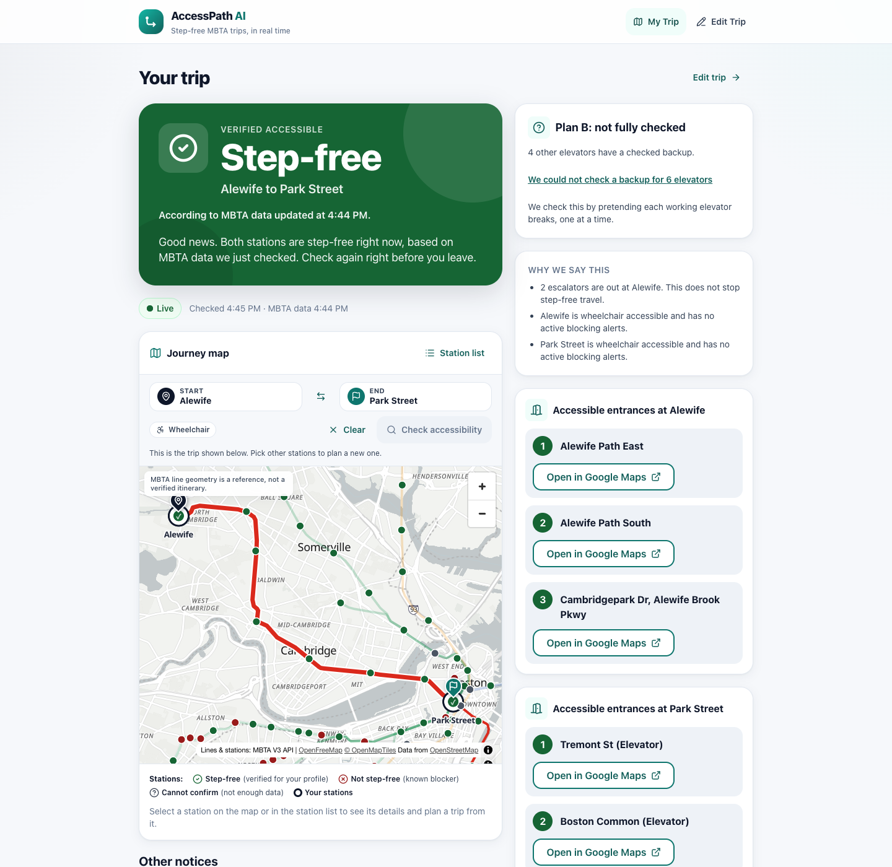
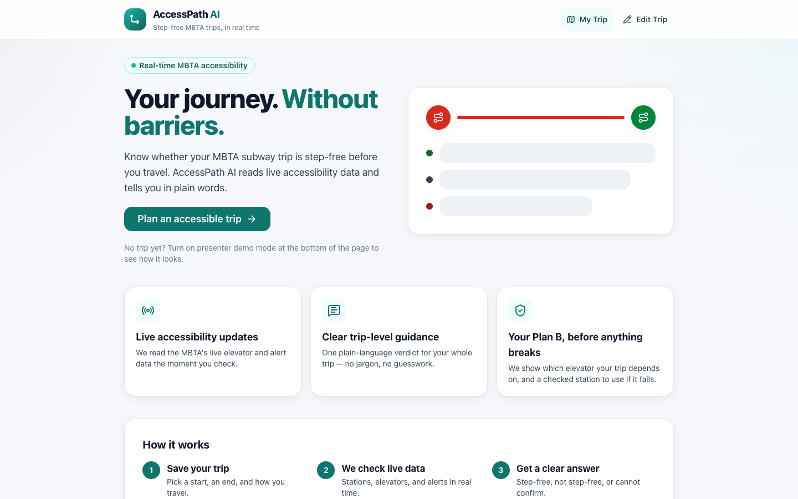
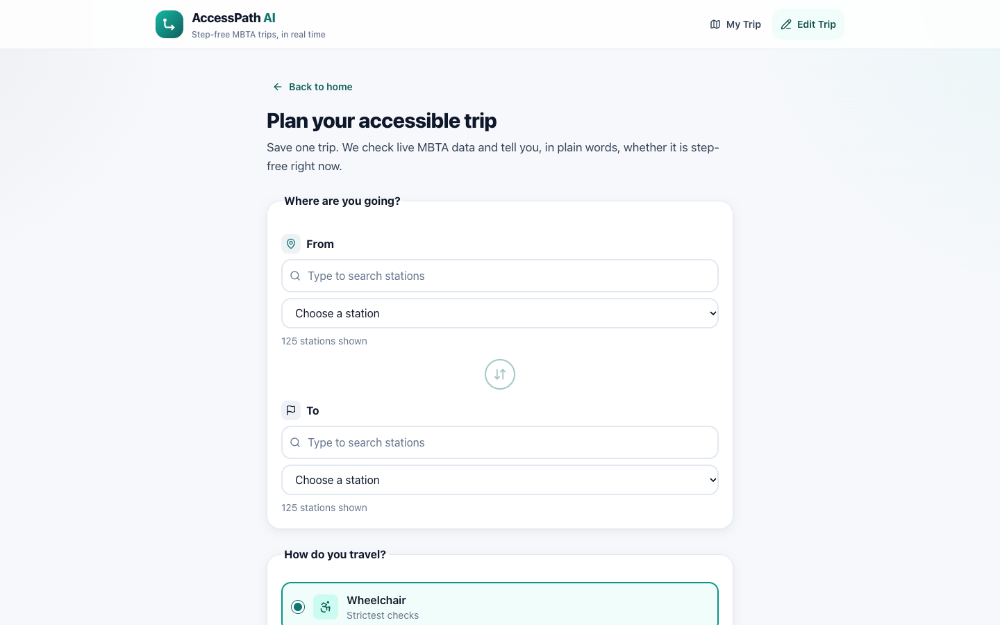
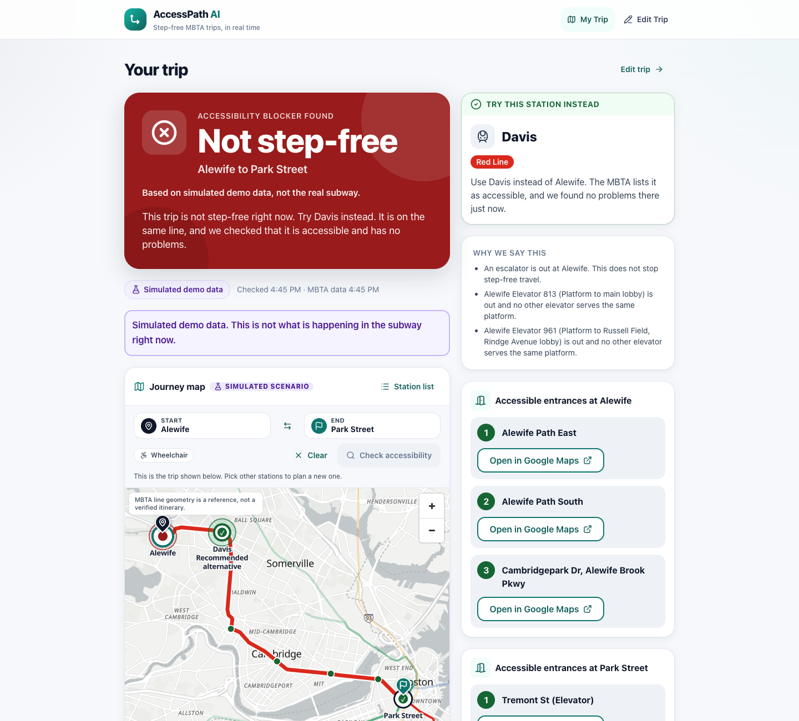
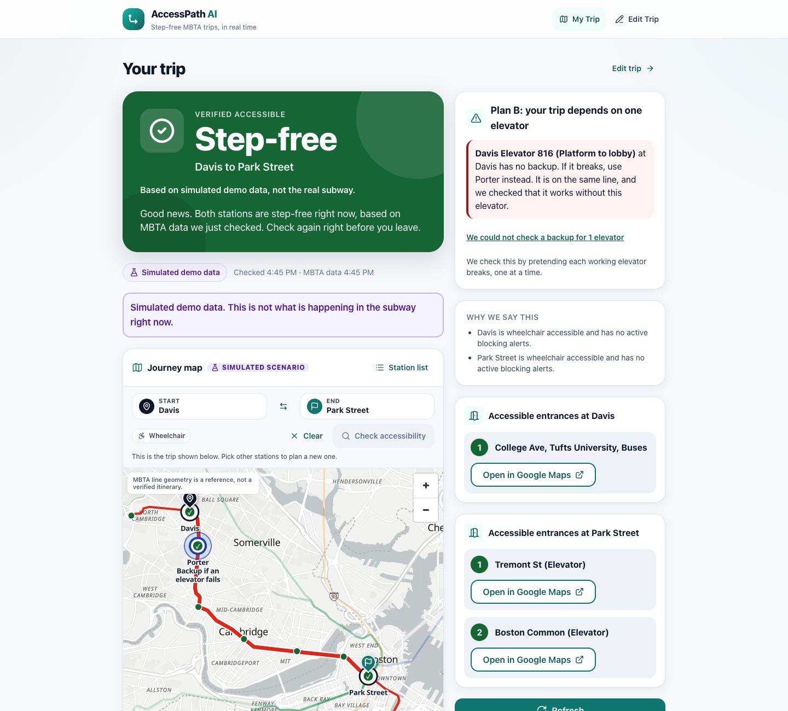
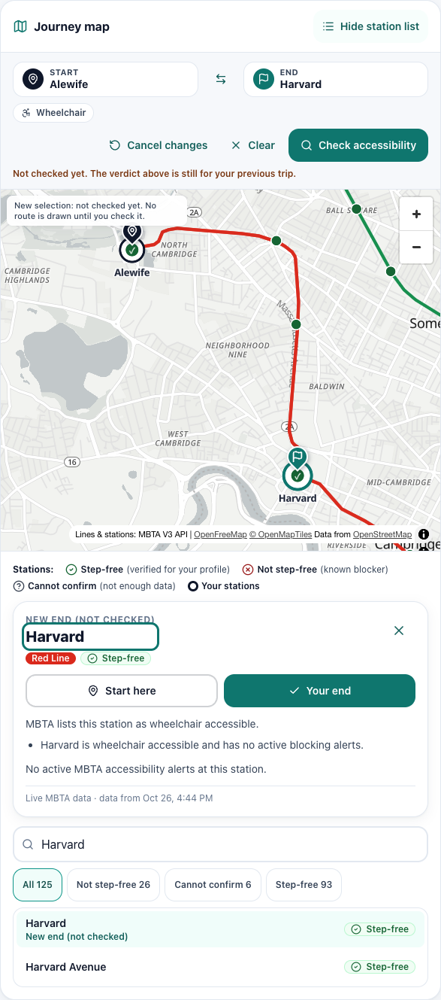
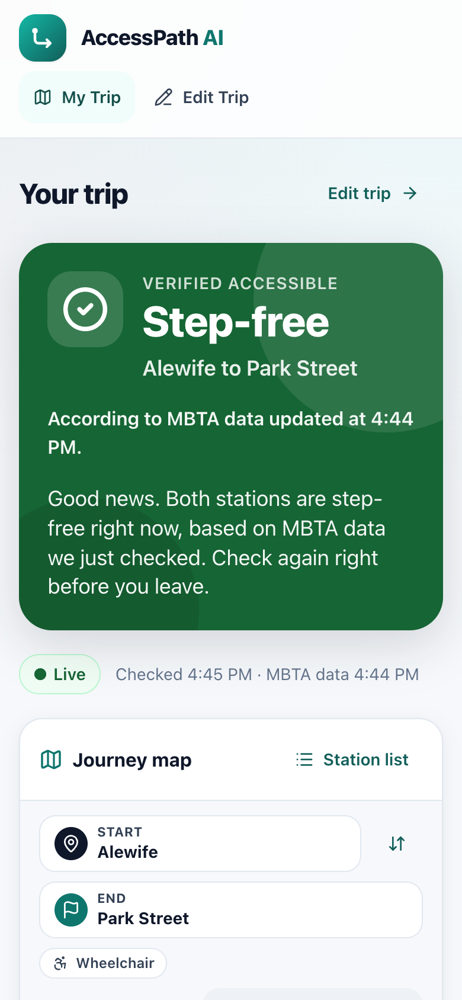
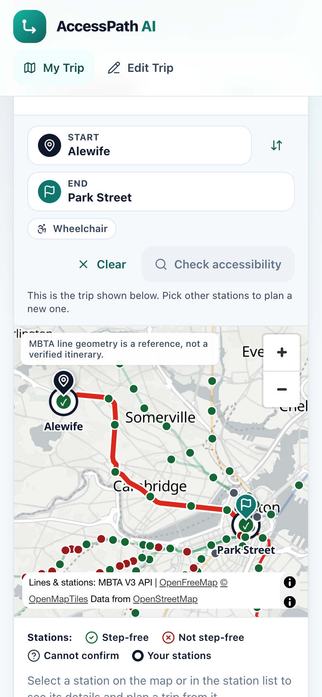

# Hackachusetts 2026 · Civic Action Track

## StepFree T

> StepFree T checks live MBTA elevator alerts against your saved trip and tells you in plain language if it’s step-free right now, and where to go instead if it isn’t.



**Team:** Aatmaj · Himani · Tanishq · Pradyumna

In the app's header the product is called **AccessPath AI**, its working name during the hackathon.

---

## Why we built it

The MBTA publishes elevator outages as alerts, one at a time, in transit language. A rider who uses a wheelchair, pushes a stroller or cannot use stairs has to work out three things before leaving home:

1. Is any elevator at my start or end station out right now?
2. If one is out, does another working elevator reach the same platform, or am I stuck?
3. If I am stuck, which station nearby on the same line works instead?

StepFree T answers all three for the rider's own trip, in one plain sentence, and shows it on a map.

## The track

**Civic action:** *"Strengthen the places, communities, and opportunities that shape daily life."*

StepFree T is closest to two of the track's challenges:

- **V3 · Safer and connected places** ("The last mile is a street, a bike, or a crash"). For many riders the last mile includes an elevator.
- **V2 · Responsive and resilient communities** ("Volume hides who is waiting, and who an alert misses"). A citywide alert feed often misses the rider who needs one particular elevator.

It is built on the track's **MBTA V3 API** data: live service alerts, subway routes, stops and facilities (elevators). The track's starter kit describes the alert feed this way: *"Use it to tell a rider what changed, in plain language, before they are already on the platform."* That is exactly what StepFree T does.

---

## What it does

| | |
|---|---|
|  |  |
| **Save a trip once.** Pick a start, an end and how you travel (wheelchair, stroller or no stairs). The trip stays in your browser; there are no accounts. | **Pick stations by name.** Type to search all 125 subway stations, then choose how you travel. |

### One clear answer

The app reads live MBTA data and gives one of three results for the whole trip:

- **Step-free** (green): both stations are accessible and nothing blocks the way right now.
- **Not step-free** (red): something blocks it, for example both platform elevators are out.
- **Cannot confirm** (gray): the data is too old, missing, or does not let us check an elevator. The app never guesses green.

It explains the result in plain language. When one elevator is out but another reaches the same platform, it names that elevator: *"Use Alewife Elevator 961 instead."*

### Journey map

Every subway station is drawn on a real map, coloured by **its own** step-free result for your profile. A green dot means that station passed every check, not just "no alert". Your route is drawn on the official MBTA line shape. A station list gives the same information as text, so keyboard and screen-reader users get it too.

### Where to go instead, and Plan B

| | |
|---|---|
|  |  |
| **A problem right now.** Both Alewife platform elevators are out, so the trip is not step-free. Davis, the nearest checked station on the same line, is circled in green on the map. | **Plan B before anything breaks.** The trip works now, but Davis has only one elevator to the platform. If it breaks, use Porter, circled in blue. |

*Both screenshots use the app's labelled demo scenarios (simulated data).*

Plan B works by pretending each working elevator at your two stations breaks, one at a time, and re-running the same check. The app also warns about **planned outages later today** (next 12 hours) that would affect your trip.

### Plan a trip on the map



Tap a station to see its details and any MBTA alerts there, with what each alert means for you. Then press **Start here** or **Go here**. Nothing changes until you press **Check accessibility**. Until then the map says plainly that the new trip is not checked yet.

### On a phone

| | |
|---|---|
|  |  |

The design is mobile-first. The verdict comes first and is announced to screen readers, tap targets are at least 44 px, and the page does not scroll sideways on a phone.

### Also

- **Accessible entrances** at each trip station, from MBTA's own data, with "Open in Google Maps" links. With a Google Maps key the app also shows street-level photos of the entrances and nearby wheelchair-accessible restrooms. These extras never change the step-free result.
- **Demo mode** (switch in the footer) with six clearly labelled simulated scenarios, so a presenter can show each state on cue.
- **Offline fallback**: if the MBTA is unreachable, the app uses a saved snapshot and says so. Old data gives "Cannot confirm", never green.

---

## How it decides

The rules live in `lib/engine/` (pure functions, no I/O) and are written down in `.kiro/steering/product.md`.

1. Missing, invalid or stale data (older than 10 minutes) gives **Cannot confirm** (`UNKNOWN`).
2. **Step-free** needs both stations to be accessible per the MBTA and no active blocking alert at either one.
3. Blocking alerts are station or stop closures, access issues, uneven platforms, and an elevator outage with no working, verified elevator to the same platform.
4. If the platform an elevator serves is not verified in `lib/data/platform-map.ts`, the result is `UNKNOWN` (`PLATFORM_UNVERIFIED`), never step-free.
5. Escalator outages are information only, and expired alerts never block.
6. A suggested alternative is on the same line, accessible, has no blocking alert, is verified step-free, and is never a trip endpoint.
7. Only verified elevators are ever named as a backup.

**Plan B** (`lib/engine/plan-b.ts`) runs only when the trip is step-free now. For each working elevator at the two stations it simulates an outage of that one elevator:

- still step-free: it has a backup (or is not on a subway path);
- not step-free: it is a single point of failure, and Plan B is the nearest station that stays verified step-free with that elevator out;
- cannot confirm: we could not check it, and the app says so.

The trip is **Resilient** only when no single elevator can break it.

**The map** (`components/map/`) only displays engine output. Each marker is `evaluateStation()` for that station (`lib/engine/station-map.ts`), so a marker can never disagree with the trip verdict. MBTA line geometry is labelled as a reference, not a verified itinerary. The highlighted route is drawn only for a trip on one line. For a trip that changes lines, the likely transfer station is shown and marked "not checked".

### Demo scenarios

Demo mode uses a **simulated** snapshot that is labelled on every screen. Real routes never use it. Open it from the footer switch, with `/?demo=<scenario>`, or through `/api/demo`.

| Scenario | Trip | Shows |
|---|---|---|
| `elevator-outage-alewife` | Alewife to Park Street | Red: both platform elevators out, alternative Davis |
| `backup-elevator-alewife` | Alewife to Park Street | Green: Elevator 813 out, "Use Alewife Elevator 961 instead" |
| `plan-b-davis` | Davis to Park Street | Green, Plan B: Davis Elevator 816 has no backup, use Porter |
| `planned-outage` | Alewife to Park Street | Green now, warning: both platform elevators close in 3 hours |
| `all-clear` | Alewife to Park Street | Green |
| `api-down` | Alewife to Park Street | Gray: data 3 hours old |

For a real Plan B case with live data, try Davis to Kendall/MIT: Davis Elevator 816 is the only elevator to the Davis platform.

---

## Run it

Needs Node.js 20 or newer.

```bash
npm install              # also copies the MapLibre map worker into public/vendor
npm run dev              # http://localhost:3000
```

The app works with no keys at all: it uses the public MBTA API and falls back to the committed snapshot.

Other scripts:

| Command | What it does |
|---|---|
| `npm test` | Unit, API, component and property tests (Vitest + fast-check) |
| `npm run typecheck` | TypeScript check |
| `npm run build` / `npm start` | Production build and server |
| `npm run snapshots` | Fetch live MBTA data into `lib/data/snapshots/mbta-snapshot.json` (the offline copy) |
| `npm run network` | Refresh the committed MBTA line geometry for the map (`lib/data/snapshots/mbta-network.json`) |
| `npm run check:gtfs -- <folder>` | Cross-check `lib/data/platform-map.ts` against MBTA GTFS `pathways.txt` (download and unzip https://cdn.mbta.com/MBTA_GTFS.zip first) |
| `npm run a11y -- [base-url]` | axe-core audit (WCAG 2.2 A/AA) in Chrome on every screen and demo state, plus a 320 px reflow check. Start the app first; set `CHROME_PATH` if needed |

### Environment variables

Copy `.env.example` to `.env.local` (git-ignored) to set any of these. All of them are optional.

| Name | What it does |
|---|---|
| `MBTA_API_KEY` | Sent as `x-api-key`. Without it the MBTA allows 20 requests per minute. One refresh uses 8 requests and is cached for 60 s. |
| `ANTHROPIC_API_KEY` | Turns on AI rewording of the explanations in `/api/explain`. Without it, built-in plain-language templates are used. |
| `ANTHROPIC_MODEL` | Model for `/api/explain` (default `claude-haiku-4-5`). |
| `EXPLAIN_AI_LIMIT_PER_MINUTE` | AI rewrites per client per minute (default 10). Over the limit, riders get the templates. |
| `GOOGLE_MAPS_API_KEY` | **Server-only.** Turns on restrooms, entrance photos and the entrance map. Enable "Places API (New)", "Street View Static API" and "Maps Static API" for the key. Never give it a `NEXT_PUBLIC_` prefix, and never commit it. |
| `FORCE_OFFLINE` | `1` skips live MBTA calls and uses the committed snapshots (testing). |
| `SNAPSHOT_WRITE` | `0` stops the dev server from rewriting the snapshot file after each live fetch. |

### API

```bash
B=http://localhost:3000
curl $B/api/health
curl $B/api/stations
curl "$B/api/status?origin=place-alfcl&destination=place-pktrm&profile=wheelchair"
curl "$B/api/alternatives?stationId=place-alfcl&profile=wheelchair"
curl "$B/api/demo?scenario=elevator-outage-alewife"
curl $B/api/network                                       # MBTA line geometry for the map
curl "$B/api/alerts?stationId=place-alfcl"
curl "$B/api/facilities?stationId=place-alfcl"
curl "$B/api/entrances?stationId=place-alfcl"             # names and links work without a key
curl "$B/api/restrooms?stationId=place-alfcl&radius=400"  # needs GOOGLE_MAPS_API_KEY
```

`/api/status` and `/api/demo` return the engine's result plus `planB`, `laterToday`, and, for the map, `stations` (every station's own result), `stationAlerts` and `journey` (same line, change of line, or unknown). Bad input returns `400 {"error","details"}`. If the MBTA is down, the routes use the offline snapshot (`"dataSource":"snapshot"`).

### Deploy to Vercel

Import the repo in Vercel (it is detected as Next.js), optionally add `MBTA_API_KEY` and `ANTHROPIC_API_KEY`, and deploy. The committed snapshots ship with the API functions (`outputFileTracingIncludes` in `next.config.mjs`). This repo has not been deployed yet.

---

## Tech stack

- **Next.js 15** (App Router, Route Handlers), **React 19**, **TypeScript**, **Tailwind CSS**, **Zod**
- **MapLibre GL** with **OpenFreeMap** tiles for the journey map
- **MBTA V3 API** for stations, alerts, facilities and route patterns
- **Vitest** and **fast-check** for example and property-based tests
- Optional: **Anthropic** for wording explanations, **Google Maps Platform** for restrooms and entrance photos
- **Kiro** for specs, steering and hooks (`.kiro/`: 5 specs, 4 steering files, 2 hooks)

## Project layout

```
app/                 pages (/, /trip/new) and Route Handlers in app/api/*
components/          verdict banner, trip form, alert, alternative, Plan B, later-today, restroom and entrance cards
components/map/      JourneyMap, TransitMap (MapLibre), TripPlannerBar, StationList, StationDetail, MapLegend
lib/types.ts         shared contract
lib/engine/          evaluate-trip, rules, find-alternative, plan-b, later-today, station-map, journey, geo
lib/data/            MBTA client, normalizing, platform map, network geometry, snapshot, cache, demo snapshot
lib/ai/              explanation (Anthropic + validation) and plain-language templates
lib/google/          Google Places, Street View and Maps Static (server-only)
lib/api/             Zod schemas, HTTP helpers, trip payload, map payload, rate limit
lib/client/          browser-only helpers: storage, demo store, status hook, trip draft, map geometry, Plan B view
scripts/             snapshot and network refresh, GTFS check, accessibility audit, map worker copy
tests/               engine (property + example), data, api, components, fixtures (real MBTA responses)
docs/screenshots/    the pictures in this README
.kiro/               steering, hooks and specs (EARS requirements, design, tasks)
```

## Tests

`npm test` runs 25 files and 295 tests. The property tests use fast-check to generate stations, alerts and platform maps and check rules such as these:

<details>
<summary>Properties checked</summary>

| Test | Rule |
|---|---|
| P1 | An active blocking alert on a trip station is never step-free |
| P6, P15 | Stale or invalid data is `UNKNOWN`, never step-free; the 10-minute boundary is exact |
| P3 | Escalator-only alerts never change a result |
| P9 | A suggested alternative is verified step-free and never a trip endpoint |
| P4 | Closing a facility never improves a verdict |
| P8 | The trip verdict equals the worst station verdict |
| P10 | The summary only gives good news for step-free, and only names a checked station |
| P11, P12, P13 | Plan B: a Resilient trip survives any single elevator outage; listed single points of failure really break the trip; every Plan B station stays step-free without that elevator |
| P14 | Outages that start later never change the "now" result |
| P16 | Conflicting sources (unknown elevator id, elevator missing from the map, unknown MBTA flag) are never step-free |
| I3, I4 | Map markers always equal that station's own engine result, and stale data turns every marker gray |
| Map | The route segment is a slice of the official line shape, and is never drawn for a change of line |
| Plan B view | The map only ever shows the engine's alternative or planB()'s backup, never both, and never an invented station |
| G1, G3, G4 | Google data never turns "unknown" into "yes", restrooms are listed only when Google says "yes", and only MBTA-marked accessible entrances are shown |

Coverage tests check that the generators reach every outcome, so no property passes by never running.

</details>

## Google features (optional)

With `GOOGLE_MAPS_API_KEY` set, the server (never the browser) calls Google:

- **Accessible restrooms nearby** (`/api/restrooms`): places within 800 m where Google says `wheelchairAccessibleRestroom` is `true`, sorted by straight-line distance, up to 5. Missing information is always "unknown", never "yes".
- **Accessible entrances** (`/api/entrances`): up to 3 entrances that the MBTA marks wheelchair accessible, in MBTA's order, each with a Street View photo, plus one map of them. A generic station photo is never shown as an entrance.

<details>
<summary>Limits of the Google features</summary>

- The entrance map was tested with mocked answers only; the Maps Static API was not enabled for the key we had.
- The nearest Street View photo sometimes shows the inside of the station or is blocked by a vehicle. The card says so.
- 36 of 125 subway stations have no entrance records in MBTA's data, and some have none marked accessible. They get a clear "couldn't find" message, which does not mean the station has no step-free way in.
- Google restroom data is often incomplete, and "open now" can be up to an hour old (results are cached).
- The Google routes have no rate limit. Before a public deploy, set a quota cap and budget alert for the key and restrict it to the three APIs above.

</details>

## Known limitations

- **Only the start and end stations are checked.** For a trip that changes lines, the transfer station is shown on the map but not checked. Buses and Commuter Rail are not covered.
- **The platform map is only partly verified.** It covers 16 stations and was cross-checked against GTFS `pathways.txt`, not by visiting stations. An outage at an unmapped elevator gives "Cannot confirm", and Plan B there says "could not check".
- Direction of travel is not modelled, so a result can be more cautious than needed.
- "Nearest" alternative means straight-line distance on the same line, not walking or ride time.
- The stroller profile uses the same rules as wheelchair. Only "no stairs" differs (uneven platforms are information only).
- Later-today warnings only see planned outages the MBTA has already posted, 12 hours ahead.
- MBTA line geometry on the map is scheduled reference data. The map tiles need an internet connection; without WebGL the app shows a simple route diagram instead.
- The AI rewording was tested against a stubbed API only. Without a key the app uses its templates.
- Accessibility was checked with axe-core in Chrome. No screen-reader pass (VoiceOver, TalkBack) or real-phone test has been done.

## Data and credits

- Transit data: [MBTA V3 API](https://www.mbta.com/developers/v3-api). MBTA terms apply. This is a hackathon project, not an official MBTA product. Always check with station staff if you are unsure.
- Map tiles: [OpenFreeMap](https://openfreemap.org), © [OpenMapTiles](https://openmaptiles.org), data © [OpenStreetMap](https://www.openstreetmap.org/copyright) contributors.
- Optional: Google Maps Platform (Places API (New), Street View Static API, Maps Static API).

Built at **Hackachusetts 2026** (October 24, 2026), Civic Action track, by Aatmaj, Himani, Tanishq and Pradyumna.
